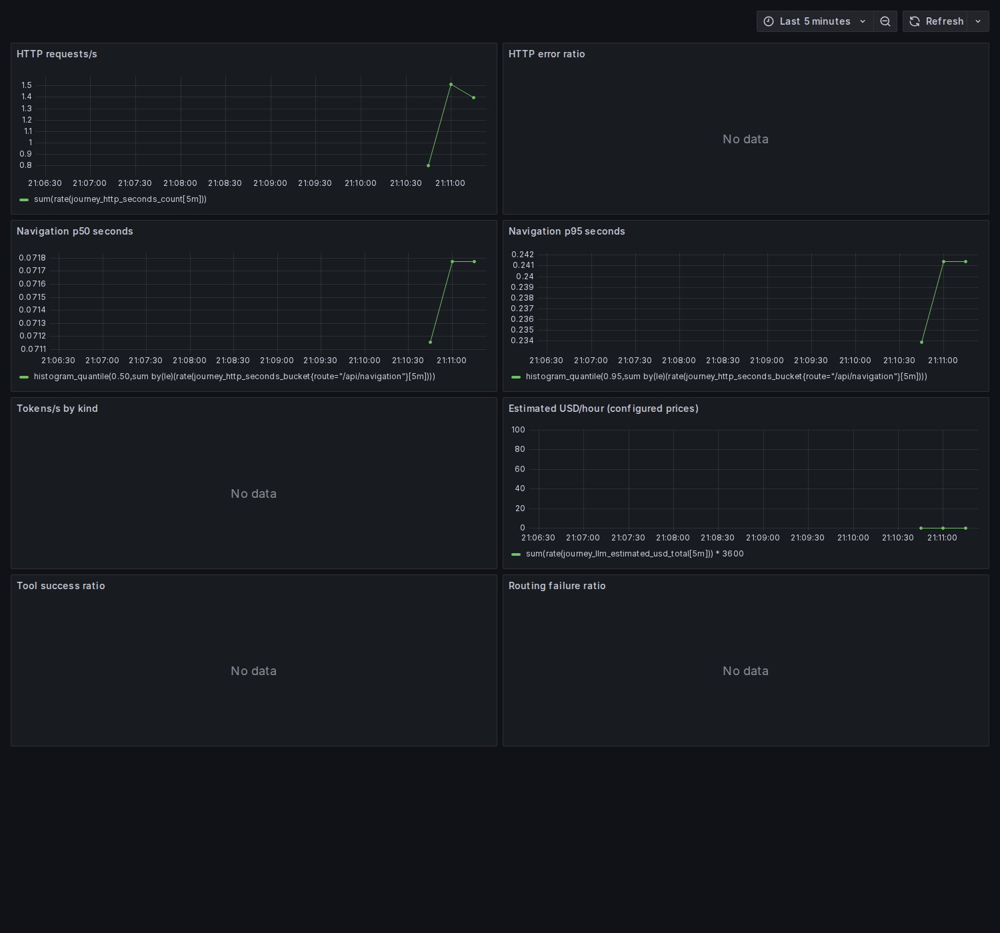

# Waterloo Journey Agent

The hosted home page prioritizes conversational journey planning. English and Chinese
requests are interpreted by a bounded LLM tool call, merged into a session plan, and
executed against real walking/driving routes and scheduled GRT transit data. Follow-up
requests preserve unchanged endpoints and constraints. Place matches require confirmation.

### Journey evaluation specification (design, pending measurement)

For conditional driving, compare the fastest **feasible** transit duration in seconds
with the user's threshold. At exactly 45 minutes retain transit; at 45 minutes and
one second also query driving. With no feasible transit, query driving if the user
enabled fallback. A driving query adds a candidate; the user's ranking preference
still determines the recommendation. Ask for a threshold when "too long" is
unspecified. Follow-ups change only the named constraints and retain confirmed places.

[Review the bilingual evaluation cases](data/journey-evaluation-cases.md).
Score extraction, deterministic route decisions, and full conversations separately.
Live extraction scores require a configured provider. Run `python journey_eval.py`:
30 cases × 3 independent trials; expected 90 calls. Temperature defaults to zero;
use `--omit-temperature` only for models that reject it. USD estimates require
documented input/output/cached per-million rates and RATE_DATE. The CI live job
uses the protected model-evaluation environment; configure required checks in
GitHub separately. Never approve secrets on unreviewed branches.

### Platform verification

[Public demo](https://natural-language-graph-query-system.onrender.com). A sleeping
Render instance may take extra time to start. The cold-start duration is unmeasured.

```text
Browser → hosted.py → NavigationSession → versioned journey prompt → model
                           ↓                    ↓ extracted constraints
                     Redis (optional)      GRT / routing API → ranked routes
                          /metrics → Prometheus → Grafana
```

From a GitHub checkout that includes source.tar.gz, first unpack the legacy base
without overwriting newer files (`tar -xkzf source.tar.gz`; existing-file warnings
can be ignored; on GNU tar use `tar --skip-old-files -xzf source.tar.gz`).
Install requirements, compile the C++ workers with `make`, then set PUBLIC_URL,
GEOAPIFY_API_KEY, LLM_API_KEY and LLM_MODEL and run `python hosted.py`.
Alternatively run `docker compose up --build` and open localhost:10000. Local
Grafana is on port 3000. Set token price variables to enable USD estimates.
Redis persists navigation state for 30 minutes; the older graph lab is per process.

Local checks, 2026-11-26: 90 Python tests passed with real disposable Redis,
including cross-instance state restoration and stale revision rejection. The
JavaScript geolocation check and Ruff correctness checks passed. Terraform
init and validate succeeded for ops/cloud. No cloud resources were created.

GitHub Actions also passed Docker build, real Redis regression tests, kind pod
replacement and an isolated CPU-load HPA check (at least three ready app replicas
from two). HPA used a local metrics server and an offline liveness-based readiness
override; provider reachability was not part of that experiment.
[Verification run](https://github.com/ebddejd/natural-language-graph-query-system/actions/runs/45896160461).
The live extraction gate failed for missing provider configuration, so release was skipped.



This dashboard capture used simulated model latency without provider usage or a
map request. Token and routing panels therefore have no observations.

HTTP benchmark: k6 + Waitress on loopback, 3 navigation turns per virtual user,
30 ms simulated model, no live provider, no confirmed endpoints or map-routing
latency. Admission allowed two active requests. With a 4-position queue,
POST failures were 68.3% at 20 VUs and 76.7% at 50 VUs. With a 12-position
queue, 60/60 and 150/150 passed, with successful POST P95 of 316 ms and 953 ms.
These short bursts measure local admission and HTTP overhead. They cannot
predict real model latency or production capacity. Reproduce with
`scripts/local_load_server.py` and `USERS=50 k6 run scripts/load.js`.

For kind, create a test cluster, build/load journey:ci, and run
`bash scripts/kind-session.sh` against that disposable cluster. This test
replaces one app pod and resumes the same cookie on another. The local Redis
deployment is ephemeral; Redis host failure is outside this experiment.
HPA requires a working cluster metrics server and CPU load to verify scale-out.

Release workflow: after passing checks on main, publish a SHA-tagged GHCR
image and deploy the matching source commit via the Render deploy hook.
Set production environment secret RENDER_DEPLOY_HOOK and variable PUBLIC_URL;
turn off Render's independent auto-deploy before enabling the gate. The smoke
check requires the expected commit, healthy dependencies, and real place matches.
Cloud Run configuration lives in ops/cloud. Initialize the registry with
image empty, push an image, then supply its digest, canonical URL, model, and
existing Secret Manager IDs. Use an authorized sandbox project, verify the
private service with an identity token, then destroy the stack.


Supported requirements: departure or arrival time (Waterloo local time), total walking
minutes, 0–2 transfers, avoiding ION, comparing walk/drive/transit, fastest/shortest/
least-walking/fewest-transfer preferences, and conditional driving fallback when transit
exceeds an explicit duration threshold or has no feasible result. Each candidate includes
server-checked evidence; failed constraints are never silently relaxed. Unsupported requests
trigger clarification. Only user-confirmed map coordinates go to routing, not the LLM context.

This is a bounded application agent, not a general autonomous navigator. Arrival-deadline
search samples departures every 20 minutes in the preceding four hours and validates actual
connections; it may miss feasible itineraries. Transit has no real-time delay/cancellation
feed. Driving excludes live traffic, parking and the walk from parking. No turn-by-turn
tracking, accessibility guarantee, fares, or intermediate-stop planning is provided.

Implementation: `journey_agent.py` (tool schema, state updates, orchestration, evidence),
`navigation.py` (session lifecycle), `transit.py` (schedule search), `web/navigation.html`
(chat-first UI). Original graph algorithms remain available at `/lab`.

Validation: `python3 -m unittest discover -s tests -p 'test_*.py'` and
`node tests/geolocation.test.js`. New regression cases cover constraint retention/removal,
clarification, coordinate privacy, impossible walking limits, conditional fallback,
mode comparison, transfer/rail restrictions and arrival deadlines.

---

# Natural-Language Graph Query System

A local portfolio project: translate English/Chinese graph questions into validated tool calls, execute minimum-hop routing in a C++ worker, and inspect the exact snapshot, route and timings in a browser.

## Quick start

Requirements: macOS/Linux, Python 3.9+, C++17 compiler, make. Python uses only the standard library.

```sh
make
make test
make eval
make run
```

Open **http://127.0.0.1:8765**. If the port is occupied: `python3 app.py --port 8766`.

Demo examples:
- `from 1 to 6`
- `from 1 to 6 avoid node 4`
- `from 1 to 6 avoid edge 3-7`
- `is there a path from 1 to 8`
- `从1到6，避开节点4`

The demo is an intentionally limited deterministic parser, **not an LLM**. It refuses unsupported suffixes instead of silently ignoring constraints. It is not conversational: clarification asks you to send a new complete request.

## Real model mode

The UI defaults to LLM mode. Open 模型设置, enter the provider URL, model and API key, then click 保存并测试连接. Keys are held in server memory only; the UI clears the password field after saving. A test passes only after a real tool call and C++ execution. No credentials are included in API responses. Alternatively set environment variables before starting; never embed keys in source or Git.

```sh
export LLM_API_KEY='your-key'
export LLM_MODEL='your-tool-calling-model'
export LLM_BASE_URL='https://api.openai.com/v1'
python3 app.py
```

Select **LLM** in the interface. The adapter uses the OpenAI-compatible Chat Completions tool-call protocol. Your model/provider must support `tools`, `tool_choice=required` and `parallel_tool_calls=false`. Local compatible providers can use a localhost URL and a placeholder key if appropriate. No third-party model call is made in demo mode. No silent fallback occurs if LLM mode is unconfigured or fails. Endpoint/model availability and billing depend on your provider.

One model call chooses `query_graph` or `clarify`; route computation and answer rendering are deterministic. Model arguments remain untrusted and are validated server-side. This is a single-step tool workflow, not an autonomous multi-agent system.

Reference: https://developers.openai.com/api/docs/guides/function-calling

**Verification status:** real provider calls were not run during initial delivery; credentials/model were not supplied. Mocked tool responses and HTTP provider behavior are tested. Do not claim measured LLM performance until running the live evaluation.

## Architecture

```text
Browser → Python local HTTP service → pin immutable graph snapshot
                                    → demo parser OR LLM tool planner
                                    → validate tool name / arguments
                                    → bounded C++ subprocess via stdin/stdout
                                    → verify path edges and endpoints
                                    → structured result + graph highlight
```

- Graphs are undirected and unweighted. BFS minimizes **edge count**, not physical distance.
- Graph publication validates the complete object before an atomic version swap.
- Each request holds an immutable snapshot reference before calling the model. Concurrent updates cannot alter its graph.
- Latest 32 versions are addressable; older in-flight references remain valid. Memory is not durable across server restarts.
- 4 active queries, 16 FIFO waiting positions, 2s queue timeout; 48 HTTP handlers maximum. 4 C++ worker slots; 250ms worker admission timeout, 3s worker timeout, 45s provider network timeout.
- Workers receive only numeric data. No shell execution or model-supplied executable names.
- Malformed worker output is rejected; tests independently verify optimality, rather than comparing exact paths when ties exist.
- Structured logs omit prompt text and credentials. Response trace includes request ID, snapshot version, tool arguments, provider token usage, planning/engine/total timings. `engine_ms` includes worker-slot wait and subprocess startup; `queue_ms` is reported separately.

## API

- `GET /api/health`
- `GET /api/graph` or `GET /api/graph?version=1`
- `POST /api/graph`: `{"nodes":4,"edges":[[1,2],[2,4]]}`
- `POST /api/query`: `{"mode":"demo","text":"from 1 to 4","graph_version":2}`
- Structured baseline: `{"mode":"structured","arguments":{"source":1,"target":6,"avoid_nodes":[4]}}`

Only positive integer vertices 1..N. Maximum 10,000 nodes, 50,000 submitted edges. Duplicate undirected edges are normalized; self-loops rejected. Avoiding a source or destination is a validation error. An unreachable destination is a successful query with `reachable=false`, not a server error.

## Evaluation

```sh
python3 evaluate.py                         # 72 fixed demo cases
python3 evaluate.py --mode structured       # 66 cases; no language interpretation
python3 evaluate.py --mode llm --limit 5    # real calls; incurs provider usage
python3 evaluate.py --mode direct-llm --limit 5
python3 benchmark.py                       # local concurrent structured requests
```

`data/benchmark.json` records the full fixed suite. Reports include per-case results, latency and usage. The direct-LLM baseline is given the graph and must compute the answer without tools. The tool-assisted condition receives a tool schema and executes the validated query. Grading uses an independent Python BFS oracle and checks legal endpoints, excluded nodes/edges and optimal hop count. Different equally short routes pass.

Initial local runs: demo **72/72**, structured **66/66**. These are template-based functional checks on a small graph, not evidence of broad natural-language generalization. Add held-out human-written paraphrases, larger graphs and repeated runs for serious model comparisons. Price is not fabricated: usage is retained, and monetary cost must be calculated using the selected provider's actual rates. Live direct-LLM versus tool comparisons are pending.

## Files and provenance

- `engine/graph.cpp`, `engine/graph.h`: copied from the user's ECE650 A3 graph implementation (including the original command parser, not used by this worker).
- `engine/main.cpp`: new numeric-protocol worker wrapper.
- `core.py`: snapshots, validation, worker admission and execution.
- `planner.py`: bilingual demo grammar and provider tool-call adapter.
- `app.py`: API and request orchestration.
- `web/index.html`: no external dependencies; SVG graph display.
- `tests/`: algorithm, concurrency, failure, API and provider-contract tests.
- `evaluate.py`, `benchmark.py`: correctness and local performance harnesses.

Original source directory: `<local-project-path>`. Original A3 is not modified. A3's random street generator is copied into generator/ and adapted to emit one batch; its geometry code provides street-to-edge membership. The original A3 driver is not used. Graphs are deliberately stable explicit snapshots, enabling reproducible AI evaluation. `PROVENANCE.json` records hashes of the copied source files.

## Limits and next steps

Local development server only, bound to loopback; no authentication, TLS, durable storage or production deployment claim. Do not expose directly to a public network. Cross-origin browser writes are rejected. HTTP handler count is bounded; this remains a local server, not a production ingress. Worker-per-request favors isolation and clarity over maximum throughput; compare a persistent worker pool before claiming an optimization. No weighted routing, real geographic data, RAG, training, GPU inference, or unrestricted multi-step agent execution.

For a stronger resume: run a real provider on held-out inputs; publish measured failure categories and improvements; record a 2-minute demo; be ready to explain BFS, snapshot consistency, validation and timeouts. Check course rules before publicly sharing code derived from assessed coursework.

## Resume wording (only what exists)

- Built a Python/C++ graph-query service with immutable versioned snapshots, constrained routing, validated tool execution and a browser-based graph visualization.
- Implemented an OpenAI-compatible LLM tool-call adapter and a reproducible evaluation harness with independent shortest-path grading; passed 72 local demo cases and 66 structured baseline cases.

Do not describe the demo accuracy as LLM accuracy. Do not claim live model validation or production deployment until completed.


## A3 自动生成图

页面的“一键生成新图”会运行独立复制的 A3 rgen 和街道交点转换程序。可设置街道数量上限、线段数量上限与坐标范围；节点和边由交点决定。原 A3 文件不变，复制的 rgen 改为每次只生成一批，不再自动循环刷新。生成成功才发布新图；失败保留旧图。JSON 编辑保留在 Advanced 中。启动时同样通过 A3 rgen → 交点转换生成图；失败时使用预先生成并校验的 A3 图。节点坐标以分数字符串保存，前端按原坐标等比例绘制。街道重命名保留几何信息；发布带 geometry 的图时，会重新计算并验证节点、边和街道归属，拒绝不一致的数据。仅不含 geometry 的旧 JSON 使用明确标注的示意布局。

## Named streets

Generated street names can be changed in the browser. Snapshots retain names and exact member edges. `source` and `target` accept either integer node IDs or exact street names; `avoid_streets` blocks all member edges while leaving intersections usable. Street-to-street queries minimize hops between ANY nodes on the two streets, so an intersection is a valid zero-hop result. Two temporary virtual nodes reduce this to one C++ BFS; they are removed before returning the route. This is a synthetic graph, not geographic navigation. Empty streets have no routable intersection nodes and produce a validation error.

Additional routes: `POST /api/graph/generate`, `GET/POST /api/model`, `POST /api/model/test`. Model configuration is local and ephemeral. Cloud providers receive the user's query and pinned street catalog. 21 automated tests pass, including street geometry, name changes, exclusion semantics and mocked HTTP model transport. Live model quality remains unmeasured until credentials are supplied.

## Service engineering extension

See [OPERATIONS.md](OPERATIONS.md) for queue limits, metric definitions, fault drills and load-test scope. Run `make faults` and `make bench`. 25 automated tests and 5 fault/recovery scenarios pass. The page exposes a manual metrics refresh panel; it makes no model calls.

## Waterloo Walks (hosted mode)

Open `/walk` on the hosted service. Set `GEOAPIFY_API_KEY` alongside the existing
`LLM_API_KEY` and `LLM_MODEL`. For local hosted-mode preview, set
`PUBLIC_URL=http://127.0.0.1:8770 PORT=8770` and run `python hosted.py`.
The original `/` graph laboratory and A3 copies remain available.

The planner extracts explicit intent, asks the user to confirm geocoded endpoints
and an extra-walking-time budget, then compares a direct pedestrian route against
up to six cafe detours and presents up to three feasible choices. Selection is an
explicit action, never a model-invented route. `walk` routing uses Geoapify's
`short` distance objective; displayed times are estimates for those routes.
Candidate search is bounded, not an exhaustive guarantee of the best cafe in town.
No live opening-state guarantee, real-time navigation, GPS tracking or traffic.

Geoapify requests are server-side; map tiles are proxied over a fixed provider
URL, with a Waterloo tile bound and 1-hour bounded memory cache. The instance
uses a conservative 1,800-request/day soft budget and a 0.3-second request spacing.
The counter/cache reset on restart; the provider dashboard remains the source of
truth for credit usage. Keep the free plan and required map/data attribution.
Exact addresses are sent to the model and map provider for requested processing;
application logs do not record those values. Visitor plans expire with sessions.
Run `python -m unittest discover -s tests -v` for automated checks.
